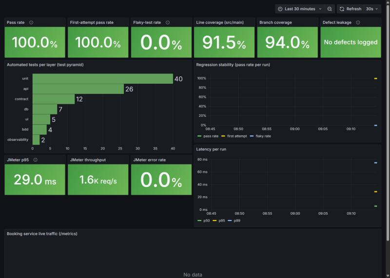

# Java Test Automation Framework

A layered QA framework in Java that tests a seat-booking service through every level of the test pyramid:
unit, API, OpenAPI contract, database, BDD acceptance, observability, UI (Playwright and Selenium) and
JMeter load. Every run produces QA KPIs (pass rate, flaky-test rate, coverage, tests per layer, p95 latency
and throughput) that CI publishes as a job summary and Grafana charts over time.



## Architecture

```
src/main/java/com/jawad/booking      System under test: JDK HttpServer + H2, JSON API, HTML page,
  BookingApp, BookingRules,          /health, /metrics (Prometheus format) and /openapi.yaml
  BookingDatabase, RequestMetrics
src/main/resources/openapi.yaml      The API contract

src/test/java/com/jawad/qa
  unit/           Pure logic: validation rules, metrics, the KPI calculator itself
  api/            REST Assured: JSON bodies, headers, status codes, negative matrix
  contract/       Atlassian OpenAPI validator on every request and response
  db/             JDBC checks behind the API: rows, schema, constraints, concurrency
  bdd/            Cucumber scenarios on JUnit Platform
  observability/  Readiness, request IDs, metrics, database-failure behaviour
  ui/             Playwright (Chromium, Firefox, WebKit) and Selenium page objects
  kpi/            QaKpiReport: Surefire + JaCoCo + JMeter results -> JSON, Prometheus, Markdown

performance/jmeter/booking-load.jmx  Create -> read -> list journey, JMeter via jmeter-maven-plugin
observability/                       Pushgateway, Prometheus and a provisioned Grafana dashboard
quality/defects.csv                  Defect ledger used for the defect-leakage KPI
```

Every test class starts its own service on a free loopback port with its own in-memory database, so test
classes never share state and can run in any order. Tests reach the service only through HTTP or a separate
JDBC connection, the same way an external test suite would.

## Test strategy and pyramid

| Layer | What it proves | Tests | Share |
| --- | --- | ---: | ---: |
| Unit | Validation rules, UUID parsing, paging, metrics format, KPI maths | 40 | 42% |
| API | Status codes 200/201/204/400/404/405/413/415, headers, JSON shape, negative payloads | 26 | 27% |
| Contract | Each operation and error response matches `openapi.yaml`; drift is detected | 12 | 13% |
| Database | Persisted rows, rejected writes, schema, PK/CHECK constraints, 50 concurrent writes, SQL injection | 7 | 7% |
| UI (Playwright) | Booking journey, list refresh, server and browser validation, accessibility labels | 5 | 5% |
| BDD | Business scenarios in Gherkin | 4 | 4% |
| Observability | Health under database failure, request IDs, error counters | 2 | 2% |
| **Total** | | **96** | |

The Selenium profile adds 1 more browser test (the booking journey in Chrome); in CI the Playwright class
also runs again on Firefox.

Most checks sit at the fast lower layers and the browser layer is kept small. Rules are tested at the unit
level, HTTP behaviour at the API level, and the UI tests cover only what only a browser can show: rendering,
native form validation and the page's use of the API.

### How the contract tests work

`OpenApiContractTest` attaches `OpenApiValidationFilter` to REST Assured, so each response is checked
against `openapi.yaml` (status code, headers, schema, `additionalProperties: false`). Negative tests check
only the response, because their requests break the contract on purpose. A dedicated test feeds the
validator responses with an extra field, a wrong type and an undocumented status, and expects all three to be
reported. As a mutation check, adding a required `seat` property to the `Booking` schema made 4 contract
tests fail.

### Flaky tests

Surefire re-runs a failing test up to twice (`-Dreruns=2`). A test that passes on re-run is counted as
**flaky**, not green, and reported in the first-attempt pass rate and flaky-test rate.

## Measured results

Local run on 2026-11-13: Windows 11, Intel i5-12450H, 16 GB, JDK 17. The numbers come from the generated
`target/qa-kpis/kpis.json`.

| Metric | Value |
| --- | --- |
| Automated tests | 96 across 7 layers, 100% pass rate, 0 flaky |
| `mvn clean verify` (91 non-browser tests + coverage gate) | 55 s wall clock |
| Playwright suite (5 tests, Chromium) | 49 s wall clock, mostly browser start-up |
| Line / branch coverage of `src/main` | 91.5% / 94.0% (gate: 80% / 70%) |
| JMeter, 20 threads for 30 s | 48,481 samples, 1,639 req/s, p50 6 ms, p95 29 ms, p99 75 ms, 0 errors |

Load numbers depend on the machine; the 250 ms p95 budget is a regression gate for this service, not a
production SLA. CI repeats every measurement on each push, and the latest values are in that run's job summary.

## Run locally

Requires JDK 17+ and Maven 3.9. Docker is needed only for the dashboard.

```bash
mvn clean verify                 # unit, API, contract, DB, BDD, observability + coverage gate
```

```bash
mvn -Dexec.classpathScope=test -Dexec.mainClass=com.microsoft.playwright.CLI "-Dexec.args=install chromium firefox" exec:java
```

```bash
mvn test -Pplaywright            # Chromium; -Pfirefox for Firefox, -Dbrowser=webkit with -Pplaywright for WebKit
```

```bash
mvn test -Pselenium              # needs Chrome; -Dselenium.chrome.binary=/path if not on PATH
```

```bash
./performance/jmeter.sh          # starts the service on port 8085, runs JMeter, stops it
```

```bash
mvn exec:java -Dexec.classpathScope=test -Dexec.mainClass=com.jawad.qa.kpi.QaKpiReport "-Dexec.args=target/qa-kpis target"
```

`JMETER_THREADS` and `JMETER_DURATION` change the load, and `-Dkpi.p95BudgetMs=` changes the latency budget.
The JMeter HTML dashboard is written to `target/jmeter/reports/`, and the Allure report comes from
`mvn allure:report` (or `mvn allure:serve`).

### QA KPI dashboard

```bash
docker compose -f observability/docker-compose.yml up -d
```

```bash
./observability/push-kpis.sh
```

Open http://localhost:3000. Grafana is provisioned with the **QA KPIs** dashboard showing pass rate,
first-attempt pass rate, flaky rate, coverage, defect leakage, tests per layer, regression stability across
runs, JMeter p50/p95/p99, throughput and error rate. If the service runs with `BOOKING_PORT=8085`, Prometheus
also scrapes its live `/metrics`. Each push of a new run adds a point to the trend panels.

Defect leakage is the share of defects in `quality/defects.csv` (`id,found_in`) found in `production` rather
than `pre-release`. The ledger is empty, so the panel shows "No defects logged" instead of an invented number.

## CI/CD

`.github/workflows/quality.yml` runs on every push and pull request:

1. **test**: `mvn clean verify`, with JaCoCo gate, Surefire and Allure reports
2. **browser**: matrix of Playwright Chromium, Playwright Firefox and Selenium Chrome, with traces and screenshots on failure
3. **performance**: JMeter load test, with HTML dashboard and CSV results
4. **kpis**: downloads every job's artifacts, computes the KPIs, fails if p95 exceeds the budget, and writes the KPI table to the run summary
5. **release**: on a `v*` tag, after all gates pass, publishes the tested source to GitHub Releases

## Project phases

| Tag | Scope |
| --- | --- |
| `phase-1` | JUnit 5, REST Assured, Cucumber, Selenium, booking fixture |
| `phase-2` | Playwright, Allure, GitHub Actions, JDBC checks, load gate, observability |
| `phase-3` | Service moved to `src/main`; unit layer, OpenAPI contract tests, broader API/DB/UI coverage, JMeter, JaCoCo gate, flaky-test detection, KPI exporter and Grafana dashboard |

## References

- [PirashanthJ/java-test-automation-framework](https://github.com/PirashanthJ/java-test-automation-framework) informed the Java UI, API and BDD structure.
- [SarkarPranab/Playwright-Allure-CI-CD-Framework](https://github.com/SarkarPranab/Playwright-Allure-CI-CD-Framework) informed the Playwright page objects, browser profiles, Allure and CI workflow.

## License

[MIT](LICENSE)
